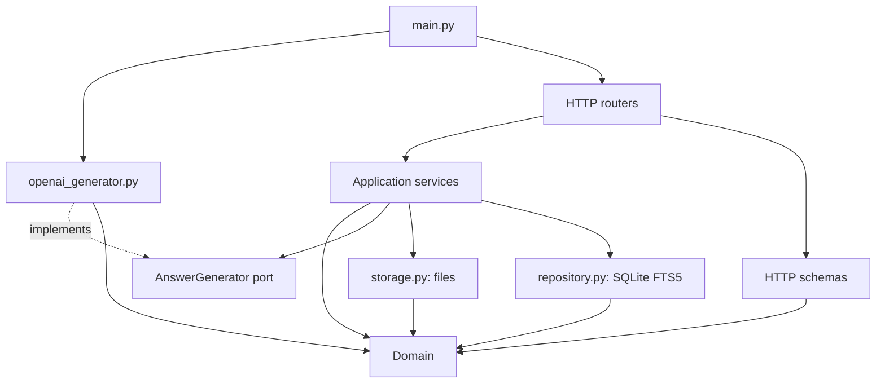
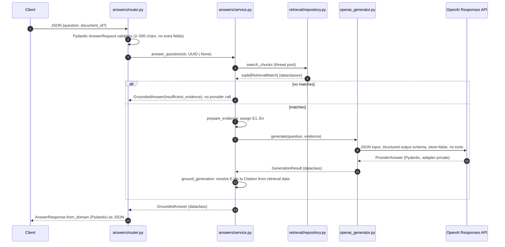

# Backend boundaries

- Status: describes the code as of milestone 4 (2026-10-16)
- Related decisions: ADR 4 (SQLite FTS5), ADR 5 (structured grounded-answer pipeline)
- Enforced by: `services/api/tests/test_architecture_boundaries.py`

This document explains how `services/api` is layered, which module may depend on
which, where blocking work runs, and where data changes type as it crosses a boundary.
For the ingestion steps themselves, see `ingestion-flow.md`.

## 1. Layers

Each feature package (`documents`, `retrieval`, `answers`) uses the same layers.

| Layer | Modules | Responsibility | May import |
| --- | --- | --- | --- |
| HTTP router | `*/router.py` | Parse requests, call one service, map the result to a schema | services, schemas, `config`, `errors`, FastAPI |
| HTTP schemas | `*/schemas.py` | Pydantic request and response models with `from_domain` | domain, Pydantic |
| Application service | `retrieval/service.py`, `answers/service.py`, `documents/extraction.py` | Use cases, status transitions, concurrency guards, error mapping | domain, ports, adapters, `errors` |
| Domain | `*/domain.py`, `retrieval/chunking.py`, `answers/prompt.py` | Immutable dataclasses and pure rules | standard library and other domain modules only |
| Port | `answers/ports.py` | `AnswerGenerator` protocol and the failures it may raise | domain |
| Adapters | `documents/storage.py`, `retrieval/repository.py`, `answers/openai_generator.py` | Files, SQLite, OpenAI | domain, ports, their own library |

Shared modules: `config.py` (typed settings from `AKP_*` variables), `errors.py` (the
`ApiError` envelope and `ErrorCode` values) and `main.py` (the app factory, which wires
the OpenAI adapter into `app.state` during startup). `retrieval/evaluation.py` and
`answers/evaluation.py` load the versioned evaluation datasets with Pydantic; they are
used by `make eval-*`, not by the HTTP API.

## 2. Rules and how they are enforced

| Rule | Why | Enforced by |
| --- | --- | --- |
| Domain modules import only the standard library and other domain modules | Domain rules stay testable without a server, database or provider | `test_architecture_boundaries.py` |
| Only `openai_generator.py` imports `openai` | The provider can change without touching services or routes | `test_architecture_boundaries.py` |
| Only `repository.py` imports `sqlite3` | The storage engine can change (roadmap week 7) behind one module | `test_architecture_boundaries.py` |
| Only `extraction.py` imports `pypdf` | The PDF parser stays replaceable | `test_architecture_boundaries.py` |
| Routers do not call adapters directly for answers | The answer use case is in one place | Code review |
| Citation metadata comes from retrieval, never from the model | Citations must be trustworthy (ADR 5) | `ground_generation` and `test_answer_domain.py` |

## 3. Where data changes type

The model sees evidence IDs, filenames, page numbers and chunk text. It returns only
claim text and evidence IDs. Document IDs, offsets and source paths in the response are
copied from the retrieval result on the server.

## 4. Pydantic versus dataclasses

- **Pydantic** is used at the edges where untrusted data enters or leaves: HTTP
  requests and responses (`*/schemas.py`), environment settings (`config.py`) and the
  provider's structured output (`ProviderAnswer`, private to the OpenAI adapter).
- **Frozen dataclasses with `slots=True`** carry data inside the application. They do
  no parsing and cannot be changed after creation. State changes create a new snapshot
  (`Document.with_status`).
- Each response schema has a `from_domain` constructor, so the mapping is in one place
  and domain objects never need to know about JSON.

## 5. Async work and threads

The API runs as one Uvicorn process with one event loop. Blocking work is moved off the
loop:

| Work | How it runs | Why |
| --- | --- | --- |
| PDF parsing (pypdf) | `run_in_threadpool` | CPU-bound and blocking |
| SQLite indexing and search | `run_in_threadpool` | `sqlite3` is a blocking driver |
| OpenAI call | `AsyncOpenAI` on the event loop | Network I/O with a native async client; 1 retry, configurable timeout |
| Upload streaming | `await upload.read()`; disk writes are synchronous | Reads are async; writes are small 64 KiB chunks |
| Sidecar reads and writes | Synchronous on the event loop | Small JSON files |

Concurrency guards for extraction and indexing are in-process sets protected by a
`threading.Lock`. They are correct for a single process only; see the known gaps in
`ingestion-flow.md`.

## 6. Errors

All failures use one envelope: `{"error": {"code": ..., "message": ...}}`. `ErrorCode`
values are public contract. Handlers in `errors.py` also convert framework errors
(validation, 404, 405) into the same envelope.

Provider failures are first translated by the adapter into port exceptions
(`GenerationTimeoutError`, `GenerationProviderError`,
`GenerationInvalidResponseError`). The answers service then maps them to
`504 generation_timeout`, `502 generation_provider_error` and
`502 generation_invalid_response`. A safety refusal is not an error: it is the
`safety_refused` outcome with `200`.

## 7. Known deviations

These are accepted for now and noted so they are not copied into new code by accident:

- **Services raise `ApiError`.** Application services and storage choose HTTP status
  codes and import `fastapi.status`. A purely layered design would raise domain errors
  and map them in the router. The current approach keeps one place per use case and
  has not caused problems yet; revisit it if a non-HTTP entry point (worker, CLI) is
  added in week 13.
- **`storage.py` takes FastAPI's `UploadFile`.** The file adapter depends on a web type.
  A worker-based ingestion path would need a plain byte stream instead.
- **Only answer generation has a port.** Storage and retrieval are concrete modules, as
  decided in milestone 4 (D4): a port is added when a second implementation exists.
  The roadmap adds a `Retriever` port in week 5, together with the semantic retriever.
