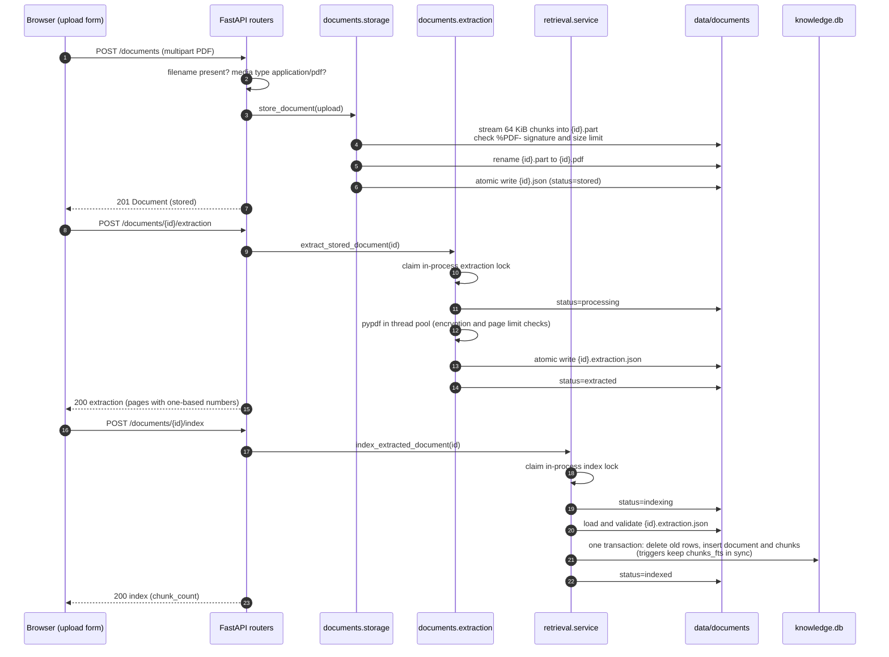
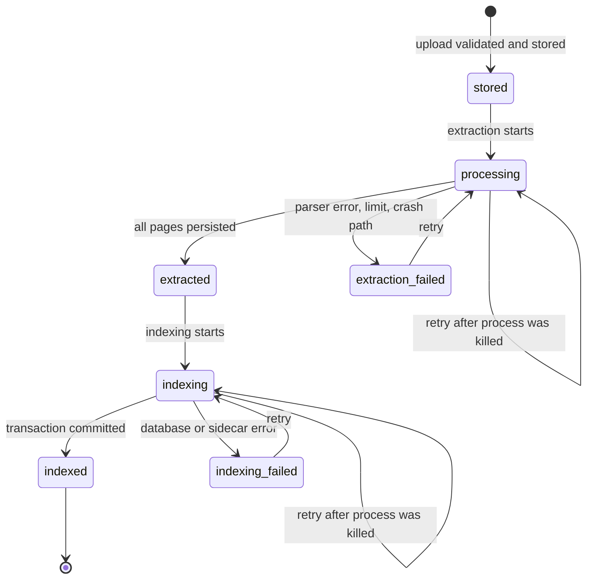

# Ingestion flow

- Status: describes the code as of milestone 4 (2026-10-16)
- Related decisions: ADR 1 (local file storage), ADR 2 (status vocabulary), ADR 3
  (extraction sidecars), ADR 4 (SQLite FTS5)

This document explains how a PDF becomes searchable evidence: which component does
each step, what is persisted, which status transitions happen and how failures and
repeats behave. It describes the current code, not a target design.

## 1. Overview

Ingestion is three separate HTTP calls, orchestrated by the browser
(`apps/web/app/upload-document-form.tsx`). The server never chains the steps on its
own: each call does one unit of work and persists its result before returning.

| Step | Endpoint | Work | Persisted output | Final status |
| --- | --- | --- | --- | --- |
| Upload | `POST /documents` | Stream, validate and store the PDF | `{id}.pdf`, `{id}.json` | `stored` |
| Extract | `POST /documents/{id}/extraction` | Parse every page with pypdf | `{id}.extraction.json` | `extracted` |
| Index | `POST /documents/{id}/index` | Chunk pages and write FTS5 rows | rows in `knowledge.db` | `indexed` |

Files live under `AKP_DATA_DIR/documents/` (default `services/api/data/documents/`).
The PDF and the JSON sidecars are the source of truth; `knowledge.db` is derived from
them.

## 2. Sequence

Each failure stops the sequence. The UI shows the error together with the work that
already completed, and offers a retry for extraction and indexing (ADR 2).

## 3. Status transitions

Each status is written to `{id}.json` before or after real work, never as a label with
nothing behind it. There is no `ready` status; answer availability depends on provider
configuration, which is not a property of the document (ADR 2).

## 4. Step details

### 4.1 Upload (`documents/router.py`, `documents/storage.py`)

- The router rejects a missing filename (`400 missing_filename`) and any media type
  other than `application/pdf` (`415 unsupported_media_type`).
- `store_document` reads the upload in 64 KiB chunks into `{id}.part`. The first five
  bytes must be `%PDF-` (`422 invalid_pdf`), and the running total must stay under
  `AKP_MAX_UPLOAD_BYTES` (`413 file_too_large`). The full file is never held in memory.
- Only after the whole payload validates is `{id}.part` renamed to `{id}.pdf` and the
  metadata sidecar written.
- The server generates the UUID and the storage name. The client filename is metadata
  only, so it cannot cause path traversal or name collisions.
- Any exception, including request cancellation (`BaseException`), deletes every file
  written for that ID. Later steps can trust what is under `data/documents/`.

### 4.2 Extraction (`documents/extraction.py`)

- An in-process set of active IDs rejects a concurrent extraction of the same document
  with `409 extraction_in_progress`.
- If the status is already `extracted` or later, the stored extraction is returned
  without parsing again. Repeating the call is safe.
- Otherwise the status becomes `processing`, any stale sidecar is removed, and pypdf
  runs in the thread pool (`run_in_threadpool`) because it is blocking, CPU-bound work.
- Encrypted PDFs (`422 encrypted_pdf`), PDFs over `AKP_MAX_PDF_PAGES`
  (`422 pdf_page_limit_exceeded`) and unparseable files (`422 pdf_extraction_failed`)
  are rejected. There is no OCR: a page without a text layer is kept as an empty page so
  page numbers stay correct.
- The sidecar is written atomically (`.part` file, then rename). On any failure the
  sidecar is removed and the status becomes `extraction_failed`.

### 4.3 Indexing (`retrieval/service.py`, `retrieval/chunking.py`, `retrieval/repository.py`)

- The same in-process lock pattern returns `409 indexing_in_progress` for concurrent
  calls. Indexing requires `extracted`, `indexing` or `indexing_failed`; other statuses
  get `409 document_not_extracted`.
- If the document is already `indexed`, the stored index row is returned. If that row
  is missing from `knowledge.db`, the call fails with `500` rather than pretending the
  document is searchable.
- `chunk_extraction` splits each page separately into windows of up to
  `AKP_CHUNK_SIZE_CHARS` characters with `AKP_CHUNK_OVERLAP_CHARS` overlap, preferring
  paragraph, line, sentence and word boundaries. A chunk never crosses a page, and each
  chunk keeps `page_number`, `chunk_index`, `start_offset` and `end_offset` into the
  page text.
- `replace_document_index` deletes the document's previous rows and inserts the new
  ones in a single SQLite transaction. Triggers keep the `chunks_fts` virtual table in
  sync. A failure leaves the old index intact and the status at `indexing_failed`.

## 5. Guarantees and known gaps

Guarantees that hold today:

- No partial PDF or sidecar is ever visible under its final name.
- Every status is backed by persisted work; failures are explicit statuses, not silent
  successes.
- Extraction and indexing are idempotent on repeat once they have completed.
- A process killed mid-step leaves `processing` or `indexing`, which the next call
  treats as retryable.

Known gaps, recorded for later milestones rather than fixed here:

- **Concurrency guards are per process.** The active-ID sets are Python objects. With
  more than one Uvicorn worker or API instance, two calls could run the same step at
  once. Today the API runs as a single process. Weeks 13–14 of the roadmap replace this
  with a database-backed queue and idempotency keys.
- **The client orchestrates.** If the browser closes after upload, the document stays
  `stored` until someone calls extraction. Server-side orchestration is planned for
  week 13.
- **No rebuild command.** `knowledge.db` is derivable from the sidecars, but there is no
  command that rebuilds it. If the database is lost, documents marked `indexed` fail
  with `500` until they are re-indexed manually.
- **Some file I/O runs on the event loop.** Writing upload chunks and reading/writing
  small JSON sidecars are synchronous calls inside `async` functions. They are short,
  but under heavy load they would block other requests.
- **Uploading is not idempotent.** Uploading the same PDF twice creates two documents.
